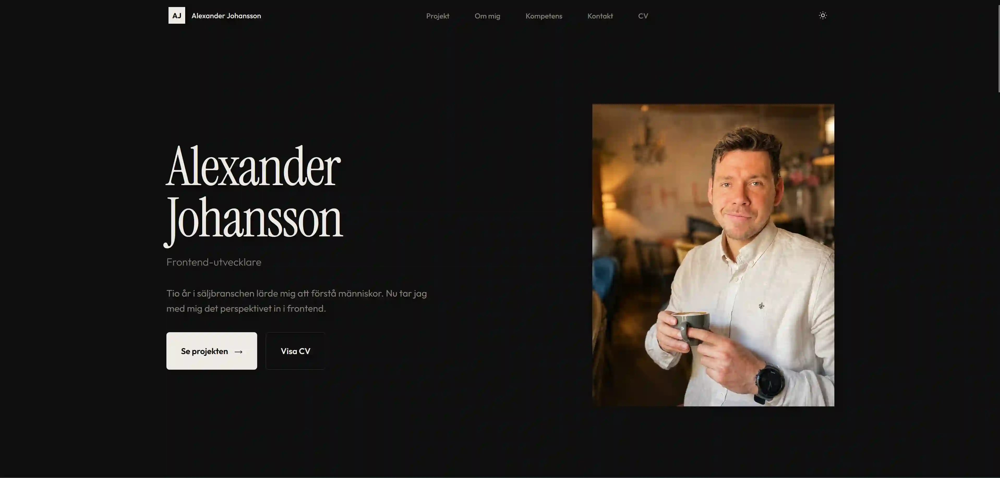
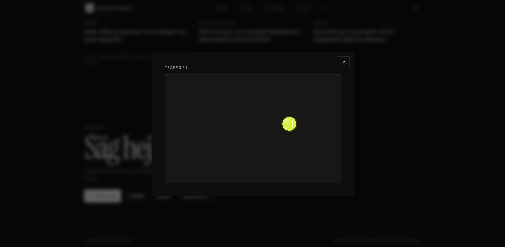
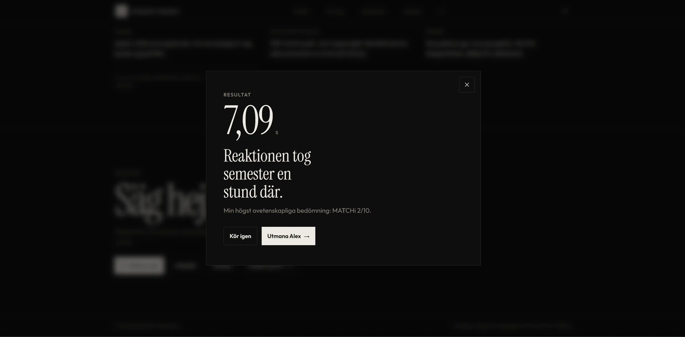
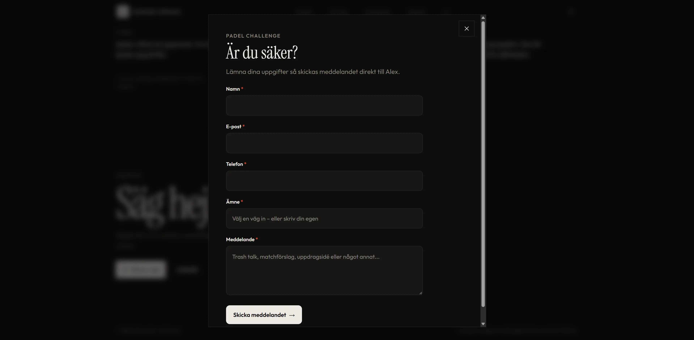

# Alexander Johansson – Portfolio

En personlig portfolio byggd i React och TypeScript med fokus på frontend, design, tillgänglighet och interaktivitet.

Projektet är gjort inom kursen **JavaScript-ramverk** på Medieinstitutet, men tanken är också att portfolion ska fortsätta användas under utbildningen och inför kommande LIA.

**Live:** https://alexander-johansson-portfolio.vercel.app/  
**GitHub:** https://github.com/AlexJCodes/alexander-johansson-portfolio-react  
**Figma:** https://www.figma.com/design/nccLjxw0hqGnuXTAXStwHz/MIN-PORTF%C3%96LJ?node-id=0-1&t=RiNFxKKbxQ2OtwLX-1



---

## Om projektet

Målet med projektet var att bygga om min tidigare portfolio till React och samtidigt bli bättre på att arbeta med komponenter, props, state och responsiv design.

Portfolion är byggd som en one-page application och är uppdelad i flera mindre komponenter och sektioner. Projektinformationen ligger i en separat datafil och renderas med `.map()`.

Under arbetets gång byggde jag även vidare på den ursprungliga idén med bland annat projektfilter, ljust och mörkt tema, animationer och en interaktiv **Padel Challenge**.

Designen började i Figma med skisser för mobil och desktop. Den färdiga sidan följer samma grund, men vissa delar ändrades och utvecklades vidare när jag började bygga sidan.

---

## Funktioner

- Responsiv one-page portfolio
- Projekt renderas från separat data
- Multi-select-filter för projekt
- Ljust och mörkt tema
- Animationer med Motion
- Scroll reveal-animationer
- Stöd för reduced motion
- Mobilnavigation med tangentbordsstöd
- Padel Challenge med reaktionsspel
- Kontrollerat formulär med validering
- Formspree för formulärhantering
- SEO och Open Graph
- `robots.txt` och `sitemap.xml`
- Testad med Lighthouse och axe DevTools

---

## Tech stack

| Område | Teknik |
| --- | --- |
| Frontend | React, TypeScript |
| Build tool | Vite |
| Styling | Tailwind CSS v4 |
| Animation | Motion |
| Formulär | Formspree |
| Design | Figma |
| Kodkvalitet | Biome |
| Deployment | Vercel |

---

## Design och arbetssätt

Jag började projektet i Figma och gjorde skisser för både mobil och desktop. Skissen gav mig en tydlig grund för layout, färger och typografi.

När jag började bygga sidan arbetade jag en del i taget. Jag försökte göra klart och testa en sektion eller funktion innan jag gick vidare till nästa.

Jag har också arbetat med separata Git-branches och små commits för olika delar av projektet. Det gjorde det lättare att hålla koll på vad som ändrades.

Några saker som växte fram under arbetets gång och inte fanns fullt ut i den första Figma-skissen var:

- multi-select-filter för projekt
- Padel Challenge
- scroll-animationer
- förbättrat dark mode
- reduced-motion-stöd
- extra tillgänglighetsarbete
- förbättringar för små mobilskärmar
- bild- och performance-optimering

---

## Projektstruktur

Jag har försökt dela upp projektet så att olika typer av kod ligger på tydliga platser.

```text
src/
├── components/
├── data/
├── sections/
├── services/
├── utils/
├── App.tsx
└── index.css
```

### `components/`

Här ligger mindre och återanvändbara komponenter, till exempel:

- `Header`
- `ProjectCard`
- `ScrollReveal`
- `PersonalCard`
- `PadelChallenge`
- `PadelChallengeForm`

### `sections/`

Här ligger de större delarna av sidan, till exempel Hero, Projects, About, Skills, Personal och Contact.

### `data/`

Projektdata ligger i `data/projects.ts`. Det gör att jag kan ändra eller lägga till ett projekt utan att behöva skriva om själva komponenten som visar projekten.

### `services/`

Här ligger kod som pratar med externa tjänster. Formspree-anropet ligger till exempel i en egen fil.

### `utils/`

Här ligger hjälpfunktioner som kan användas utan att vara direkt kopplade till en React-komponent.

---

## State

En sak jag har fått träna mycket på i projektet är **var state ska ligga**.

Jag har försökt hålla state nära den del av sidan som faktiskt använder det. Om flera komponenter behöver samma state har jag i stället flyttat upp det till en gemensam förälder.

Exempel på state i projektet:

| State | Används till |
| --- | --- |
| `selectedFilters` | Vilka projektfilter som är valda |
| `theme` | Ljust eller mörkt tema |
| `isMenuOpen` | Om mobilmenyn är öppen |
| `isPadelChallengeOpen` | Om Padel Challenge är öppen |
| `screen` | Vilken del av Padel Challenge som visas |
| `formData` | Värdena i formuläret |
| `errors` | Valideringsfel |
| `formStatus` | Status efter submit |

### Projektfiltret

Jag sparar inte den filtrerade projektlistan i ett eget state. I stället räknas den fram från alla projekt och de filter som användaren har valt.

```tsx
const filteredProjects =
  selectedFilters.length === 0
    ? projects
    : projects.filter((project) =>
        selectedFilters.some((filter) =>
          projectMatchesFilter(project, filter),
        ),
      );
```

När användaren väljer eller tar bort ett filter skapas en ny array i stället för att ändra den gamla direkt:

```tsx
setSelectedFilters((currentFilters) =>
  currentFilters.includes(filter)
    ? currentFilters.filter((item) => item !== filter)
    : [...currentFilters, filter],
);
```

Om inga filter är valda visas alla projekt.

---

## Padel Challenge – det jag är mest stolt över

Padel Challenge började som en liten idé för att göra den personliga delen av portfolion roligare.

Under projektets gång växte den till en större funktion med:

- intro
- reaktionsspel
- fem klickbara bollar
- resultat
- utmaning
- formulär
- validering
- Formspree
- feedback efter submit

Det är den del jag är mest stolt över eftersom jag fick använda flera saker jag lärt mig i React i samma funktion, bland annat state, events, och formulärhantering.

Padel Challenge använder conditional rendering för att visa olika steg beroende på spelets state – gameplay, resultat och kontaktformulär.

<p align="start">
  
  
  
</p>

---

## Ett problem längs vägen

Ett problem dök upp när jag testade Padel Challenge på små mobilskärmar.

Spelområdet blev nästan helt ihoptryckt. Jag trodde först att problemet låg i React-komponenten, men det visade sig handla om hur höjden räknades ut med flexbox och `h-full`.

Jag löste det genom att ge den mobila dialogen en tydligare höjd och låta spelområdet använda den plats som faktiskt finns kvar.

```tsx
max-sm:h-dvh
max-sm:min-h-0
```

Spelområdet fick också:

```tsx
className="relative min-h-0 flex-1 overflow-hidden ..."
```

Det var ett bra exempel på att felsökning inte alltid handlar om det man först tror. I det här fallet var det CSS-layouten som var problemet och inte React.

---

## Tillgänglighet och kvalitet

Jag har försökt tänka på tillgänglighet under hela projektet och inte bara i slutet.

Några saker jag har arbetat med:

- semantisk HTML
- labels och `aria-*` där det behövs
- skip link
- tangentbordsnavigation
- tydliga fokusmarkeringar
- Escape för att stänga mobilmenyn
- fokus tillbaka till rätt element
- färgkontraster
- reduced-motion-stöd
- testning på små skärmar

Jag har testat sidan manuellt med tangentbord och även kört **axe DevTools**, som visade **0 issues** i den slutliga kontrollen.

Jag beskriver därför projektet som testat med tillgänglighet i fokus, men inte som formellt WCAG-certifierat.

### Lighthouse

Projektet testades i production build med Lighthouse.

| Kategori | Desktop | Mobile |
| --- | ---: | ---: |
| Performance | 100 | 92 |
| Accessibility | 100 | 100 |
| Best Practices | 100 | 100 |
| SEO | 100 | 100 |

Mobile Performance förbättrades från **83 till 92** efter att jag optimerade bilder och förbättrade hur hero-bilden laddas.

---

## Kravuppfyllelse

| Krav | Hur det är löst |
| --- | --- |
| React + TypeScript | Projektet är byggt med React och TypeScript |
| SPA | Portfolion är en one-page application |
| Återanvändbara komponenter | Sidan är uppdelad i flera mindre komponenter |
| Props | Data och funktioner skickas mellan komponenter med props |
| Separat projektdata | Projekten ligger i `data/projects.ts` |
| `.map()` och key | Projekt och andra listor renderas med `.map()` |
| Minst sex projekt | Portfolion innehåller minst sex projekt |
| Hem / Om / Projekt / Kontakt | Alla delar finns med |
| Minst två meningsfulla state | State används bland annat för filter, tema, meny, dialog och formulär |
| Projektfilter | Multi-select-filter med OR-logik |
| Derived state | Projektlistan räknas fram från valda filter |
| Controlled form | Formuläret använder state för alla fält |
| Validering | Alla obligatoriska fält kontrolleras |
| Success feedback | Användaren får feedback efter lyckad submit |
| Avancerad animation | Motion används för filter och scroll-animationer |
| Responsiv design | Testad från små mobilskärmar till desktop |
| Tillgänglighet | Testad med tangentbord, axe och Lighthouse |
| Deployment | Vercel |
| README | Dokumenterar projekt, arbetssätt, state och reflektion |

---

## Reflektion

Det här projektet har framför allt hjälpt mig att förstå hur jag kan dela upp en React-applikation när den börjar bli större. I början tänkte jag mest på designen och hur sidan skulle se ut, men när fler funktioner kom in blev det tydligt att jag också behövde tänka mer på komponenter, ansvar och state.

Jag tycker att projektets struktur fungerar bra eftersom projektdata, komponenter, services och hjälpfunktioner ligger på olika platser. Jag har också försökt undvika onödigt state. Projektfiltret är ett exempel där den filtrerade listan räknas fram från de filter som redan finns i state.

Om jag började om projektet idag hade jag planerat de mest interaktiva delarna lite tidigare. Padel Challenge började ganska enkelt men växte till en mycket större funktion än jag först tänkte. I efterhand hade jag kunnat planera dess olika states och komponenter tidigare. Samtidigt lärde jag mig mycket av att lösa problemen när de dök upp.

AI har använts som ett pedagogiskt bollplank och som hjälp när jag har fastnat. Jag har bland annat använt ChatGPT för att få saker förklarade, diskutera olika lösningar, granska kod och felsöka tillsammans.

Målet har varit att förstå koden jag skriver och inte bara låta AI bygga projektet åt mig. När jag har fått kodförslag har jag försökt förstå varför lösningen fungerar innan jag har använt den, och sedan testat den själv i projektet.

Det jag är mest nöjd med är att portfolion inte bara blev en statisk sida. Den känns personlig och innehåller flera funktioner där jag har fått använda det vi har arbetat med i kursen.

---

## Kör projektet lokalt

Klona repot:

```bash
git clone https://github.com/AlexJCodes/alexander-johansson-portfolio-react.git
```

Gå till projektmappen:

```bash
cd alexander-johansson-portfolio-react
```

Installera dependencies:

```bash
npm install
```

Skapa en lokal environment-fil utifrån exemplet:

```bash
cp .env.example .env.local
```

Lägg in ditt Formspree-endpoint i `.env.local`.

Starta utvecklingsservern:

```bash
npm run dev
```

### Övriga scripts

```bash
npm run build
npm run preview
npm run check
npm run check:fix
```

---

## Länkar

- **Live:** https://alexander-johansson-portfolio.vercel.app/
- **GitHub:** https://github.com/AlexJCodes/alexander-johansson-portfolio-react
- **Figma:** https://www.figma.com/design/nccLjxw0hqGnuXTAXStwHz/MIN-PORTF%C3%96LJ?node-id=0-1&t=RiNFxKKbxQ2OtwLX-1

---

Byggd av Alexander Johansson  
Frontend Developer student @ Medieinstitutet